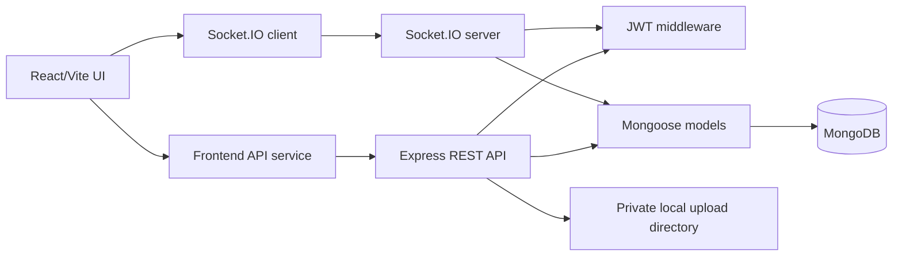

# ChatSphere system architecture

## Responsibilities and request flow

- **Frontend:** React routes preserve the original responsive ChatSphere interface; local theme/read-receipt preferences and the public profile use browser storage. `src/services/api.js` sends credentialed requests to `VITE_API_BASE_URL`; signed-out sample content stays local.
- **Authentication:** Register/login validate inputs, bcrypt-hash passwords, and set a signed JWT in a Secure, HttpOnly, SameSite cookie while returning public profile data. Protected APIs verify cookie claims and load the user; profile password hashes are excluded. Logout clears the cookie; server-side JWT revocation is not implemented.
- **REST API:** Express mounts auth, conversations/messages, groups, demo payments, and upload routes. Route handlers validate data and enforce membership/admin/ownership rules. Database-dependent routes fail clearly with 503 while MongoDB is disconnected.
- **Database:** Mongoose models persist users, conversations, messages, and demo transactions. See [database design](./DATABASE_DESIGN.md).
- **Real-time:** Socket.IO authenticates with the same browser cookie as HTTP. Each requested room join is checked against current conversation membership. The backend emits persisted sends/mutations and typing/read/group events to room and authenticated user channels. Client reconciliation uses message IDs and client-generated idempotency IDs.
- **Attachments:** Multer writes allow-listed files up to 10 MB to a private local directory. Downloads require a valid session and current conversation membership.
- **Payments:** The API creates pending demo-only transaction records and exposes a separate sender-authorized simulated verification route. There is no payment provider, settlement, or money transfer.

## Configuration, deployment, and limitations

`backend/.env` controls backend port, exact frontend CORS origin, cookie SameSite mode, database URI, JWT signing secret/expiry, upload directory, and environment mode. Vite uses `VITE_API_BASE_URL`. During development, the backend can start without MongoDB; `/api/health` reports degraded and `/api/health/database` returns 503. API routes requiring persistence also return 503.

Rate limits are held in process memory, so they are only a single-instance development safeguard. Before production, use shared rate limiting, HTTPS, CSP and XSS prevention, secure deployment secrets, least-privilege MongoDB, private durable object storage, file content scanning, monitoring, backup/recovery, and multi-instance Socket.IO infrastructure. Presence, cloud file storage, external identity/email providers, calling, and real provider-backed payments are not implemented.
